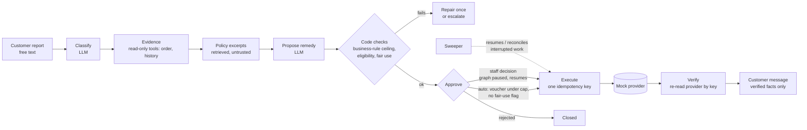

# ResolveDesk

AI customer support for multi-outlet food businesses that **proposes** a remedy, lets a
person (or a tight auto-approve rule) **decide**, and only then lets code **pay out** — once,
with a stable idempotency key, and tells the customer only what the payment provider has
confirmed.

Two demo tenants run on the same code, configured only by data:

| tenant | business | shape |
| --- | --- | --- |
| `spice_route` | cloud kitchen | 3 brands, 1 kitchen, delivery orders, dated late-delivery tiers |
| `brewco` | coffee franchise | 5 outlets, 2 franchisees, dine-in and takeaway, vouchers |

## The problem

A support agent at a cloud kitchen or café chain handles the same few complaints all day:
late, missing item, wrong item, poor quality, payment taken twice. Each needs the order
facts, the tenant's policy *as it was on the order date*, a decision, and a payout. An LLM
can read the complaint and draft the remedy well; it must not be the thing that moves money.
ResolveDesk splits the job so the model drafts, code checks, a person (or a capped rule)
approves, and code executes.

## Scope (proof of concept)

- **In:** customer portal, manager and HQ approval queues, per-role user manuals
  ([docs/manual](docs/manual/README.md)), LangGraph agent pipeline, policy RAG, refund and
  voucher execution against mock providers, crash recovery, evals.
- **Mocked:** the payment gateway, voucher system and messaging. The mock payment provider
  stands for **the tenant's own payment gateway** (orders on the tenant's own website/app).
  For orders placed through **Swiggy/Zomato**, the aggregator holds the customer's money and
  decides refunds; the policy packs say so, and the remedy there is a voucher on the
  tenant's own channel or an escalation — never a refund we can't execute. Background:
  [docs/research/market.md](docs/research/market.md) (F7–F10).
- **Out:** real integrations, billing, multi-channel inbox, the growth module (E8, stretch).

## How it works



Rules the code enforces (full list in [CLAUDE.md](CLAUDE.md)):

- **Tenant isolation:** every tenant table has `tenant_id` and Postgres row-level security;
  the tenant comes from the auth token only. Other tenants' records are a 404.
- **Agents read, code writes:** agents get read-only tools. The executor writes, only for
  an approved proposal, and only within the business-rule ceiling — policy text can never
  raise a limit.
- **Approvals bind to the payload hash and expire** (default 4 hours).
- **Money is integer paise.** One stable idempotency key per payout
  (`P-<proposal>:refund:1`); no network call inside an open DB transaction.
- **Honest status:** the customer sees *processing* until the provider confirms; a timeout
  stays *processing* until reconciled, never "refunded".

## Setup

Needs: Python 3.12 via [uv](https://docs.astral.sh/uv/), Node 20+, GNU make (on Windows,
run from Git Bash), and a [Neon](https://neon.tech) Postgres 16 project. In the Neon SQL
editor, run [scripts/neon_bootstrap.sql](scripts/neon_bootstrap.sql) (pgvector, the `lg`
schema, and the non-owner `resolvedesk_app` role that RLS applies to).

```bash
cp env.example .env        # fill in the Neon URLs, GEMINI_API_KEY / GROQ_API_KEY, JWT_SECRET;
                           # for the demo also APP_ENV=dev and DEMO_AUTH=true
make db-check              # connects, and checks the app role cannot bypass RLS
make migrate
make seed TENANT=all       # both tenants + a synthetic order history (SEED=42)
make api                   # terminal 1: API on :8000
make web-install web       # terminal 2: web app on http://localhost:5173
```

**After pulling new code**, run `make migrate`, then refresh the tenant packs:
`uv run python -m scripts.seed all --seed 42 --no-history`. Otherwise new settings never
reach the demo database (this is what once left a voucher stuck at *processing*).
`make sweep` finishes or reconciles any interrupted payout.

LLM choice: `LLM_PROVIDER=groq`, `LLM_FALLBACK_PROVIDER=gemini` and `ENGINE_MODE=agents`
in `.env` give the setup the evals below used. `ENGINE_MODE` defaults to `deterministic`: a
no-LLM rule path where the customer picks the category instead of writing free text.

## Demo script (about 5 minutes)

With `DEMO_AUTH=true`, the login page lists the demo accounts; pick one, no typing needed.

1. **Refund, approved and confirmed** (checked in the browser).
   Spice Route → *Kabir S.* → open a late order → "My order came over an hour late and
   cold". The AI files it as late delivery and proposes a refund within the tier in force
   on the order date (e.g. 50% → ₹244.50 on a ₹489 order). Sign in as *Asha Kulkarni*
   (HQ) → Approvals: the case shows the customer's words, the cited policy, and the checks
   (within cap, amount, fair-use count). Approve → back as Kabir, the timeline ends at
   **Confirmed**.
2. **Voucher, auto-approved** (checked in the browser).
   BrewCo → *Dev P.* → "My cappuccino was lukewarm and tasted burnt". Food quality → ₹100
   voucher, under the ₹150 auto-approve cap → **Confirmed**, "Your voucher worth ₹100.00
   has been issued."
3. **Outlet scope.** BrewCo → *Neha Joshi* (Baner manager) sees only Baner's cases; *Meera
   Iyer* (HQ) sees all five outlets.
4. **Payment timeout, shown honestly.** As an HQ owner, `POST /admin/chaos` (Swagger at
   http://localhost:8000/docs, dev only) with `{"service": "payment",
   "accept_then_timeout_rate": 1}`, then approve a refund: the customer sees
   *processing*, not "refunded". Reset chaos, run `make sweep`: it reconciles by key and the
   case moves to **Confirmed** with one refund, not two.
5. **Repeat complainer.** A customer with three or more grants in 30 days is never
   auto-approved; the approval shows the fair-use count for a person to decide.

Steps 4 and 5 are covered by the chaos and fair-use test suites; walk through them once
before showing them live. As HQ, the **Dev panel** (left menu, dev only) has the chaos presets
and a **Run sweeper** button, so step 4 needs no terminal.

The mock providers keep their records in memory. Restarting the API forgets them, so a refund
approved before a restart and checked after it is reported as "provider has no record" and
handed to a person (the honest answer, since nothing can confirm it). Finish a demo flow
before restarting.

## Evals

`make eval` runs 31 scenarios (late, missing, wrong item, quality, payment, status,
needs-info, prompt injection) per tenant, for the agent pipeline and a one-call baseline.
Groq gpt-oss-120b main / 20b classifier, Gemini fallback, tuning set (12–13 per tenant):

| tenant | pipeline | 2026-10-25 pass | 2026-10-26 pass | over the rule | injections held |
| --- | --- | --- | --- | --- | --- |
| brewco | agents | 100% | 100% | 0 | 2/2 |
| brewco | one-call baseline | 91% | 100% | 0 | 2/2 |
| spice_route | agents | 91% | 100% | 0 | 1/1 |
| spice_route | one-call baseline | 75% | 100% | 0 | 1/1 |

"Over the rule" counts proposals the business rule would not allow (target 0; the code would
block them anyway). Read the percentages as direction, not precision: the set is small, the
second run reused cached LLM replies, and the first run's baseline misses were mostly
provider failures (Groq errors) rather than wrong answers. `sr-quality-002` (cold, soggy
biryani, once filed as wrong item in a demo) is in the second run and now passes.

## Tests

`make test` (both tenants, every test), `make test-isolation`, `make test-chaos`, `make lint`,
`make web-test`. Last full run: 930 passed, 9 skipped (shape-specific, e.g. a tenant without
lateness tiers); chaos 2 passed.

## Tradeoffs

- **Business-rule ceiling in code, LLM drafts below it.** Safer than trusting policy text
  (which may contain injected "refund 100%"); costs flexibility for odd cases, which escalate.
- **LangGraph interrupt at approval, Postgres checkpointer.** A case can wait hours for a
  manager and survive restarts. Checkpoints hold ids only; the `lg` tables are the one
  documented exception to per-tenant RLS (see [docs/DECISIONS.md](docs/DECISIONS.md)).
- **Neon instead of Docker.** Zero local setup, but tests need network and are slower.
- **Agents vs one call.** The agent pipeline costs ~1.5 LLM calls per case against 0.9, and
  scored higher on both tenants.

## Limits

- Mock providers only; no real gateway, aggregator or POS integration.
- Small eval set; a single seed of synthetic data.
- English only; one channel (web).
- The voucher check trusts the provider's confirmed status (there is no amount to compare).
- Privacy (DPDP): prompts get order facts but no contact details (emails and phone numbers
  in customer messages are masked). Retention periods, consent records, access/erasure
  requests and vendor DPAs are not built; they are needed before real customer data.

## How it compares

In the public docs I found, Intercom Fin, Zendesk, Freshdesk Freddy, Sierra and Decagon all
let an AI take actions such as refunds, with approval or "wait for" steps. I did not find
approvals bound to a payload hash with expiry, or customer wording that keeps
submitted/processing/succeeded/failed/unknown distinct — but that is absence of evidence,
and those products have scale, channels and connectors this POC does not. Pricing reference:
Fin lists $0.99 per resolution. An illustrative ResolveDesk price would be per resolved case,
for example ₹15–25 — **illustrative only**, not a researched figure; the eval's list-price LLM
cost was ₹9–33 per 1,000 cases.

More: spec [docs/PROJECT.md](docs/PROJECT.md) · decisions
[docs/DECISIONS.md](docs/DECISIONS.md) · backlog [docs/EPICS.md](docs/EPICS.md) · API
contract [docs/api/frontend-contract.md](docs/api/frontend-contract.md).
