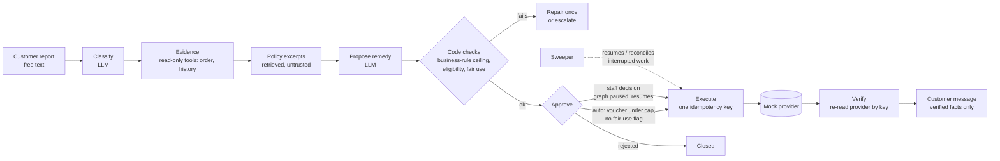

# ResolveDesk

[](https://github.com/anurag-singh2001/ResolveDesk/actions/workflows/ci.yml)

AI customer support for multi-outlet food businesses that **proposes** a remedy, lets a
person (or a tight auto-approve rule) **decide**, and only then lets code **pay out** — once,
with a stable idempotency key, and tells the customer only what the payment provider has
confirmed.

Two demo tenants run on the same code, configured only by data:

| tenant | business | shape |
| --- | --- | --- |
| `spice_route` | cloud kitchen | 3 brands, 1 kitchen, delivery orders, dated late-delivery tiers |
| `brewco` | coffee franchise | 5 outlets, 2 franchisees, dine-in and takeaway, vouchers |

## The problem

A support agent at a cloud kitchen or café chain handles the same few complaints all day:
late, missing item, wrong item, poor quality, payment taken twice. Each needs the order
facts, the tenant's policy *as it was on the order date*, a decision, and a payout. An LLM
can read the complaint and draft the remedy well; it must not be the thing that moves money.
ResolveDesk splits the job so the model drafts, code checks, a person (or a capped rule)
approves, and code executes.

## Scope (proof of concept)

- **In:** customer portal, manager and HQ approval queues, per-role user manuals
  ([docs/manual](docs/manual/README.md)), LangGraph agent pipeline, policy RAG, refund and
  voucher execution against mock providers, crash recovery, evals.
- **Mocked:** the payment gateway, voucher system and messaging. The mock payment provider
  stands for **the tenant's own payment gateway** (orders on the tenant's own website/app).
  For orders placed through **Swiggy/Zomato**, the aggregator holds the customer's money and
  decides refunds; the policy packs say so, and the remedy there is a voucher on the
  tenant's own channel or an escalation — never a refund we can't execute. Background:
  [docs/research/market.md](docs/research/market.md) (F7–F10).
- **Growth (stretch):** the `growth` flag is on for both demo tenants. A nightly-style job spots
  a drop in an outlet's repeat-customer rate and proposes a win-back campaign with a holdout
  group. A campaign needs two different staff approvals (one an HQ owner, and not the person
  who proposed it) and is sent once per customer, to consented customers only. After the
  window it reports a verdict (worked / did not work / inconclusive) and an offer ROI against
  the held-out group. Staff screens (all read-only except where noted): **Dashboard** (charts
  by day or week, drill down by brand and location), **Segments** (customer segments and
  first-order cohorts, counts only), **Insights** (per-outlet table, HQ and franchisee
  owners), **Growth** (signals, campaigns, approval, ROI, and a manual-spend form for HQ),
  **Brand signals** (HQ only) and **Campaign calendar** (overlap and frequency-cap warnings,
  which warn and never block). Endpoints under `/growth` and `/insights` (see
  http://localhost:8000/docs). What is proven: the campaign flow and ROI are tested end to end
  on BrewCo. On Spice Route the seed has no campaign audience and only two staff users, so the
  same flow is not yet proven there (planned as S12.6, not in this branch).
- **Platform portal (operator):** a separate sign-in at `/platform` with Health, Scheduled
  jobs, Logs and alerts, AI performance and a **Scenario lab** (edit scenario files and run a
  few on a scratch database). Off until the platform admin is configured; see the
  [runbook](docs/RUNBOOK.md). On the demo, the rows on Jobs, AI performance, Logs and Alerts
  are **seeded demo rows** (`scripts/seed_portal_demo.py`, labelled `demo`), not real activity.
- **Out:** real integrations, billing, multi-channel inbox.

## How it works



Rules the code enforces (full list in [CLAUDE.md](CLAUDE.md)):

- **Tenant isolation:** every tenant table has `tenant_id` and Postgres row-level security;
  the tenant comes from the auth token only. Other tenants' records are a 404.
- **Agents read, code writes:** agents get read-only tools. The executor writes, only for
  an approved proposal, and only within the business-rule ceiling — policy text can never
  raise a limit.
- **Approvals bind to the payload hash and expire** (default 4 hours).
- **Money is integer paise.** One stable idempotency key per payout
  (`P-<proposal>:refund:1`); no network call inside an open DB transaction.
- **Honest status:** the customer sees *processing* until the provider confirms; a timeout
  stays *processing* until reconciled, never "refunded".

## Setup

Needs: Python 3.12 via [uv](https://docs.astral.sh/uv/), Node 20+, GNU make (on Windows,
run from Git Bash), and a [Neon](https://neon.tech) Postgres 16 project. In the Neon SQL
editor, run [scripts/neon_bootstrap.sql](scripts/neon_bootstrap.sql) (pgvector, the `lg`
schema, and the non-owner `resolvedesk_app` role that RLS applies to).

```bash
cp env.example .env        # fill in the Neon URLs, GEMINI_API_KEY / GROQ_API_KEY, JWT_SECRET;
                           # for the demo also APP_ENV=dev and DEMO_AUTH=true
make db-check              # connects, and checks the app role cannot bypass RLS
make migrate
make seed TENANT=all       # both tenants + a synthetic order history (SEED=42)
make api                   # terminal 1: API on :8000
make web-install web       # terminal 2: web app on http://localhost:5173
```

**After pulling new code**, run `make migrate`. With `APP_ENV=dev` it also runs `make refresh`,
which re-applies the tenant packs, settings and policies from `tenants/` (idempotent; it never
touches order history and does nothing when `APP_ENV` is not `dev`). Without that, new settings
never reach the demo database (this is what once left a voucher stuck at *processing*).
`make sweep` finishes or reconciles any interrupted payout.

LLM choice: `LLM_PROVIDER=groq`, `LLM_FALLBACK_PROVIDER=gemini` and `ENGINE_MODE=agents`
in `.env` give the setup the evals below used. `ENGINE_MODE` defaults to `deterministic`: a
no-LLM rule path where the customer picks the category instead of writing free text.

## Demo script

The full walkthrough, with steps for both tenants and each role (customer, location manager,
franchisee owner, HQ owner, and the platform portal), is in
[docs/DEMO-SCRIPT.md](docs/DEMO-SCRIPT.md) (about 15 minutes; the first five steps are the
original 5-minute demo). With `DEMO_AUTH=true` the login page lists the demo accounts; pick one,
no typing needed.

The chaos step (a payment that times out after accepting) and the repeat-complainer step are
covered by the chaos and fair-use test suites; walk through them once before showing them live.
As HQ, the **Demo controls** page (left menu, dev only) has the chaos presets and a **Run
sweeper** button, so no terminal is needed.

By default the mock providers keep their records in memory. Restarting the API forgets them, so
a refund approved before a restart and checked after it is reported as "provider has no record"
and handed to a person (the honest answer, since nothing can confirm it). To keep them across
restarts, set `MOCK_STATE_FILE=var/mock_state.json` in `.env` (dev only): the mocks reload that
file at startup and rewrite it after every change. Chaos settings are not saved. The Demo controls page
also has a **Simulated clock** (+1h to +15 days, reset) to see approvals expire without waiting.

## Evals

`make eval` runs the scenario files in `tenants/<slug>/scenarios/` (42 now: 22 Spice Route and 20 BrewCo, of which 8 are held out and read-only in the lab; late, missing, wrong item, quality, payment, status, loyalty,
privacy requests, needs-info, prompt injection, and Hinglish / Devanagari Hindi messages) per
tenant, for the agent pipeline and a one-call baseline. Groq gpt-oss-120b main / 20b classifier,
Gemini fallback, tuning set. It refuses to reseed the demo database:
point it at a scratch one.

The table below is from the 2026-10-25 to 2026-10-27 runs on the smaller set that existed then (36 scenarios, tuning set 14 BrewCo and 16 Spice Route). It has not been re-run on the 42 now in the repo.

| tenant | pipeline | 2026-10-25 | 2026-10-26 | 2026-10-27 | over the rule | injections held |
| --- | --- | --- | --- | --- | --- | --- |
| brewco | agents | 100% | 100% | 100% | 0 | 2/2 |
| brewco | one-call baseline | 91% | 100% | 78% | 0 | 2/2 |
| spice_route | agents | 91% | 100% | 93% | 0 | 1/1 |
| spice_route | one-call baseline | 75% | 100% | 93% | 0 | 1/1 |

"Over the rule" counts proposals the business rule would not allow (target 0; the code would
block them anyway). Read the percentages as direction, not precision: the set is small and one
synthetic seed. The 2026-10-26 run reused cached LLM replies; the 2026-10-27 run made fresh calls
(report `evals/reports/eval-20261027-143533.md`). Its one agent miss, `sr-quality-002`, proposed
a ₹60 voucher where the rule allows ₹150: under the rule, so safe, but not the expected amount.
The baseline's misses were two "ask for more detail" answers, one escalation of a wrong-item case
and one provider failure (Groq rate limit, Gemini error). The three new Hinglish / Hindi
scenarios (`sr-late-006`, `sr-missing-004` in Devanagari, `bc-missing-004`) passed on both
pipelines; the older Hinglish `bc-wrong-002` failed on the baseline only.

## Tests

**`make test` is not a full run.** It runs `pytest -m "not isolation and not chaos and not live"`:
unit and integration tests for both tenants, but not the isolation suite, the chaos suite or the
live-LLM tests. The other commands are `make test-isolation`, `make test-chaos`, `make lint` and
`make web-test` (vitest). A full run is all of those, plus `make eval` if prompts or agents changed.

A single pytest run against the remote database takes over four hours, and one network drop
spoils the rest. `scripts/run_test_batches.py` splits the suite (unit, and the chaos,
integration and isolation folders) into batches of about 60 tests, runs them in parallel with
one worker per database, retries batches lost to the network, and saves each result as it
finishes:

```bash
uv run python -m scripts.run_test_batches --env a.env --env b.env   # start or resume
uv run python -m scripts.run_test_batches --env a.env --rerun-failed # only what failed
uv run python -m scripts.run_test_batches --status                   # print progress
uv run python -m scripts.run_test_batches --fresh --env a.env        # forget saved results
```

Each `--env` file holds one database's settings as `KEY=value` lines (one file per database, so
two workers never share a database). Progress is in `.test-runs/status.md` (and
`.test-runs/state.json`; logs in `.test-runs/logs/`, none of it committed). Saved results belong
to one commit: after new commits, use `--fresh`. The runner does not run vitest or `tests/live`.

Last recorded full run (2026-10-27, one process, after Sprints 4 and 5): 1312 passed, 12 skipped
(shape-specific, e.g. a tenant without lateness tiers or without the growth flag), 2 failed. Both
failures were the admin-sweep test expecting an out-of-date list of report fields after two
parallel branches each added one; fixed in the next commit and re-run green (14 passed). Chaos:
green three times in a row. Web: 83 passed. **That is the last full run recorded here; it
predates Sprints 6 to 12.** A fresh full run on the latest code is part of S12.12.

**CI.** GitHub Actions (`.github/workflows/ci.yml`) runs on every push and pull request with
no secrets and no database: `ruff check`, `ruff format --check`, the unit tests
(`tests/unit`) and, for the web app, `npm ci`, the vitest suite and a production build. The
DB-backed integration, isolation and chaos suites need Neon, so they run locally
(`make test`, `make test-isolation`, `make test-chaos`).

## Tradeoffs

- **Business-rule ceiling in code, LLM drafts below it.** Safer than trusting policy text
  (which may contain injected "refund 100%"); costs flexibility for odd cases, which escalate.
- **LangGraph interrupt at approval, Postgres checkpointer.** A case can wait hours for a
  manager and survive restarts. Checkpoints hold ids only; the `lg` tables are the one
  documented exception to per-tenant RLS (see [docs/DECISIONS.md](docs/DECISIONS.md)).
- **Neon instead of Docker.** Zero local setup, but tests need network and are slower.
- **Agents vs one call.** The agent pipeline costs ~1.5 LLM calls per case against 0.9, and
  scored higher on both tenants.

## Limits

- Mock providers only; no real gateway, aggregator or POS integration.
- Small eval set; a single seed of synthetic data.
- One channel (web). Customer messages are templated in English, Hinglish (`hi-Latn`) and
  Devanagari Hindi (`hi`), in the language the customer writes in (there is no language picker);
  they are not generated, and no other language is supported. The customer Privacy pages are in
  the same three languages. Staff screens are English only. The Hindi and Hinglish wording still
  awaits native review ([docs/HINDI-REVIEW.md](docs/HINDI-REVIEW.md)). Inbound Hinglish
  classification is covered by only a few eval scenarios.
- The voucher check trusts the provider's confirmed status (there is no amount to compare).
- Growth ROI is proven on one tenant (BrewCo). Its cost is an upper bound (the budget cap) and
  message cost and gross margin are labelled estimates. Manual spend is entered by hand, not
  verified, and is not apportioned to any campaign.
- Portal pages on the demo show seeded demo rows, not real activity.
- Privacy (DPDP): the position is **not counsel-checked**; prompts get order facts but no contact details (emails and phone numbers
  in customer messages are masked). `make retention` (dry run; `APPLY=1` to redact, irreversible) redacts message text and contact data
  on cases finished more than `support_retention_days` ago (default 365, never lower; provisional,
  not legal advice; legal hold is set in the DB only). Marketing consent history, data download
  and erasure requests are built but provisional, not legal advice. Vendor DPAs are not built,
  and the retention periods for order and payment records are not researched. Get counsel's view
  before real customer data.

## How it compares

In the public docs I found, Intercom Fin, Zendesk, Freshdesk Freddy, Sierra and Decagon all
let an AI take actions such as refunds, with approval or "wait for" steps. I did not find
approvals bound to a payload hash with expiry, or customer wording that keeps
submitted/processing/succeeded/failed/unknown distinct — but that is absence of evidence,
and those products have scale, channels and connectors this POC does not. Pricing reference:
Fin lists $0.99 per resolution. An illustrative ResolveDesk price would be per resolved case,
for example ₹15–25 — **illustrative only**, not a researched figure; the eval's list-price LLM
cost was ₹9–33 per 1,000 cases.

More: spec [docs/PROJECT.md](docs/PROJECT.md) · decisions
[docs/DECISIONS.md](docs/DECISIONS.md) · backlog [docs/EPICS.md](docs/EPICS.md) · API
contract [docs/api/frontend-contract.md](docs/api/frontend-contract.md).
